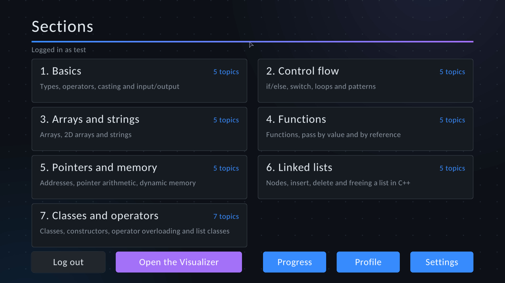
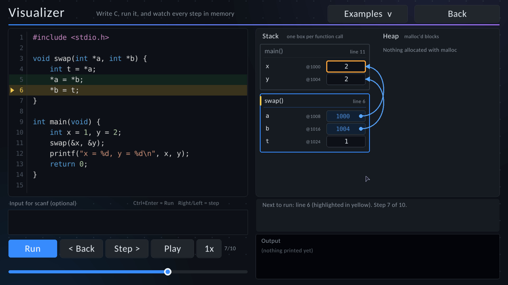
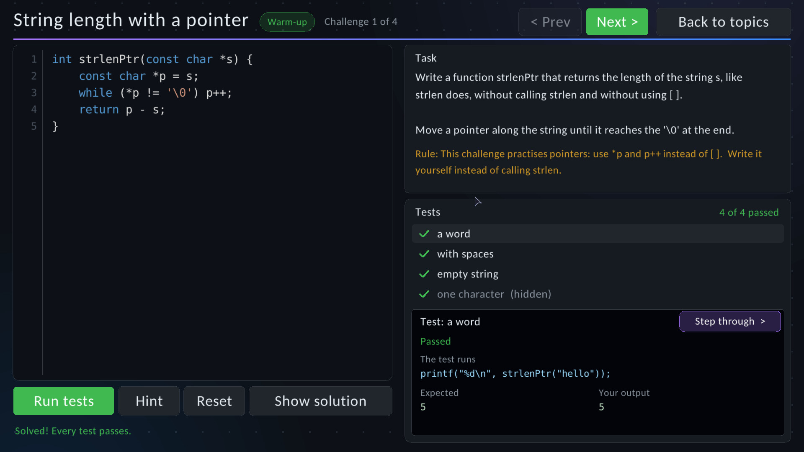

This project was started from the raylib game template ([www.raylib.com](https://www.raylib.com)), which is licensed under an unmodified zlib/libpng license.

_Copyright (c) 2014-2026 Ramon Santamaria ([@raysan5](https://github.com/raysan5))_

-----------------------------------

## C Learning App



### Description

An interactive desktop app for learning C and C++, written in C with [raylib](https://www.raylib.com). It covers seven sections (Basics, Control flow, Arrays and strings, Functions, Pointers and memory, Linked lists, Classes and operators). Each section has paged lessons, coding challenges and a section exam.

The headline feature is the **Visualizer**: our own C interpreter, written in C, that runs your code one statement at a time and draws the stack, the heap and the pointers between them. Instead of crashing, it explains bugs such as NULL dereferences, use after free, out-of-bounds indexes and memory leaks in plain language.

This was built as a 3rd-year class project on building software with AI assistance.

### Features

 - **Lessons** with four kinds of page: explanations with code and its real output, step-by-step memory traces, "predict the output" questions and quizzes
 - **Visualizer**: write or paste C code and step through it line by line, forwards and backwards, watching variables, stack frames, heap blocks and pointer arrows change. Includes example programs, some of them with deliberate bugs
 - **Coding challenges** (19, across six sections): write a function and run it against tests, see expected and actual output side by side, then open any failing test in the Visualizer
 - **Section exams** with multiple-choice and typed answers, drawn from a pool of 22-23 questions each, unlocked by finishing the section's quizzes
 - **Accounts and progress tracking**: sign in, see your best scores, recent activity and what to practise next, and continue where you left off
 - Dark IDE-style interface that scales to any window size, with full-screen support

### Controls

Mouse: click buttons, cards and answers; scroll with the wheel or drag the scroll bars.

Keyboard:
 - `Esc` - go back one screen (or leave the code editor)
 - `F11` or `Alt+Enter` - toggle full screen
 - Visualizer: `Ctrl+Enter`, `Ctrl+R` or `F5` runs the code; `Right`/`Left` (or `F10`/`F9`) steps forwards/backwards; `Space` plays; `Home`/`End` jumps to the start/end
 - Lesson pages: `V` opens the current code example in the Visualizer
 - Coding challenges: `Ctrl+Enter` or `F5` runs the tests
 - Code editor: the usual shortcuts (`Ctrl+C`/`Ctrl+X`/`Ctrl+V`, `Ctrl+Z` undo, `Shift`+arrows to select)

### Building

You need CMake 3.24 or newer and a C compiler. CMake downloads raylib 6.0 automatically.

```
cmake -B build
cmake --build build
```

Run the program from the `build` folder: the `resources` folder is copied next to it. A Makefile is also included in `src/`.

To check the lesson content after editing it (needs `gcc`, `g++` and Python 3):

```
python3 tools/verify_content.py
```

This compiles every code example and challenge solution and checks the outputs written in the lessons. `docs/CODEBASE_GUIDE.md` explains how the code is organised.

### Screenshots




### Developers

 - $Damon Kelly - lesson content, Visualizer and C interpreter, coding challenges, UI theme
 - $Andrii Shyiko - sign-in and accounts, profile and settings, progress tracking, "continue where you left off", animations

### Use of AI

$We used a variety of AI tools including Claude, Chatgpt and Gemini. The goal of this project was to get experience building with the use of generative AI and also to see what is possible with AI. We made sure to understand and verify changes made by the AI. 

### License

This project sources are licensed under an unmodified zlib/libpng license, which is an OSI-certified, BSD-like license that allows static linking with closed source software. Check [LICENSE](LICENSE) for further details.

Third-party components:
 - [raylib](https://github.com/raysan5/raylib) - zlib/libpng license, Copyright (c) 2013-2026 Ramon Santamaria and contributors
 - Carlito font (`src/resources/Carlito-Regular.ttf`) - SIL Open Font License 1.1, see `src/resources/Carlito-LICENSE.txt`
 - DejaVu Sans Mono font (`src/resources/DejaVuSansMono.ttf`) - Bitstream Vera / DejaVu fonts license, see `src/resources/DejaVu-LICENSE.txt`

*Copyright (c) 2026 $Damon Kelly and $Andrii Shyiko*
